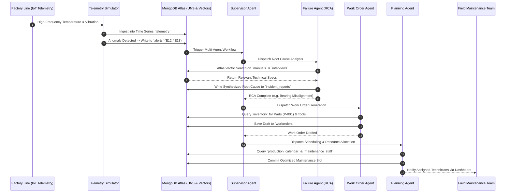
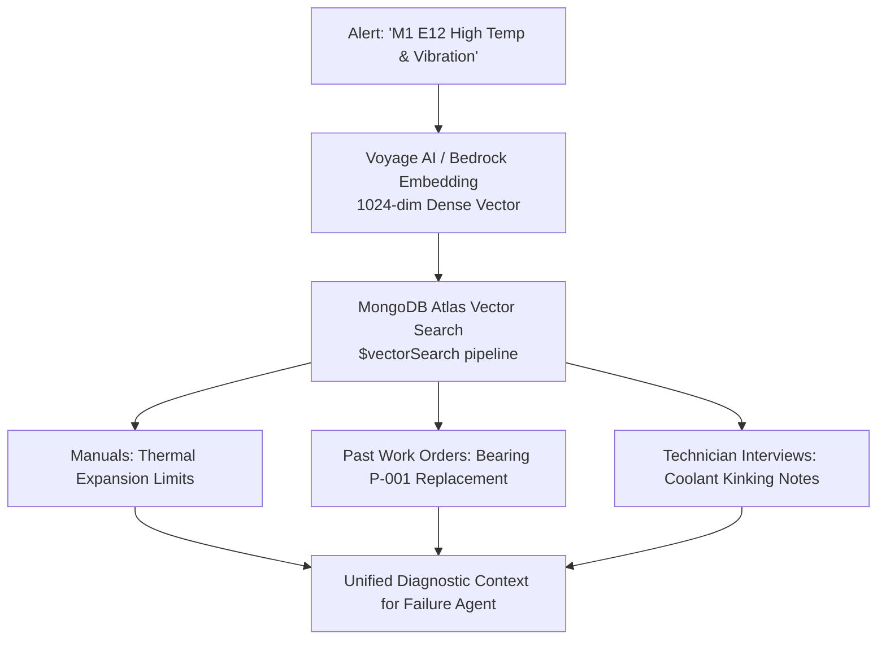

# Multi-Agent Predictive Maintenance System

<div align="center">

[](https://nextjs.org/)
[](https://aws.amazon.com/bedrock/)
[](https://www.langchain.com/langgraph)
[](https://www.mongodb.com/products/platform/atlas-vector-search)
[](https://www.voyageai.com/)
[](https://www.docker.com/)
[](LICENSE)
[](https://github.com/ashok9847/agentic-predictive-maintenance-aws-bedrock-genai)

**Autonomous Multi-Agent Industrial Plant Operations Orchestrated by LangGraph.js, AWS Bedrock Foundation Models, and MongoDB Atlas Vector Search.**

*Autonomous Failure Diagnostics · Root Cause Analysis · Automated Work Order Dispatch · Zero-Disruption Production Calendar Scheduling · Serverless AWS Lambda Deployment*

</div>

---

## Table of Contents

1. [Executive Summary & The Autonomous Shift](#1-executive-summary--the-autonomous-shift)
2. [Key Engineering Concepts & Multi-Agent Architecture](#2-key-engineering-concepts--multi-agent-architecture)
3. [Multi-Agent Choreography & Collaboration Flow](#3-multi-agent-choreography--collaboration-flow)
4. [Specialized Autonomous Agents Breakdown](#4-specialized-autonomous-agents-breakdown)
5. [Operational Data Foundation & Unified Namespace (UNS)](#5-operational-data-foundation--unified-namespace-uns)
6. [Hybrid Retrieval & Unified Domain Vector Search](#6-hybrid-retrieval--unified-domain-vector-search)
7. [AWS Cloud & Serverless Lambda Deployment](#7-aws-cloud--serverless-lambda-deployment)
8. [Technology Stack Reference](#8-technology-stack-reference)
9. [Quick Start & Local Setup](#9-quick-start--local-setup)
10. [Operational Scripts & Utilities](#10-operational-scripts--utilities)
11. [Interview-Ready Master Guide: 12 Architectural Q&As](#11-interview-ready-master-guide-12-architectural-qas)
12. [Author & Maintainer](#12-author--maintainer)
13. [License](#13-license)

---

## 1. Executive Summary & The Autonomous Shift

Manufacturing facilities generate terabytes of OT (Operational Technology) sensor feeds and IT work records daily. Traditional predictive maintenance stops at issuing a passive threshold alert:
* A sensor triggers an alarm.
* An engineer manually browses dense equipment PDF manuals.
* A planner manually verifies replacement parts inventory in ERP.
* A supervisor manually negotiates with production managers to find an idle maintenance window.

This fragmented, human-bottlenecked workflow results in hours of unplanned production halts. **Multi-Agent Predictive Maintenance System** bridges this operational divide by transforming passive failure predictions into **autonomous, coordinated plant action**.

Orchestrated with **LangGraph.js**, backed by **MongoDB Atlas** as the unified data and vector search foundation, and powered by **AWS Bedrock** foundation models (Anthropic Claude 3.5 Sonnet / Haiku), this platform deploys specialized AI agents that collaboratively detect, diagnose, draft, and schedule maintenance interventions in real time without human latency.

---

## 2. Key Engineering Concepts & Multi-Agent Architecture

* **Decentralized Multi-Agent Specialization**: Rather than overburdening a single monolithic prompt, the system segregates responsibilities across modular agents: `Supervisor`, `Failure Detection & RCA`, `Work Order Dispatcher`, and `Production Planning Scheduler`.
* **LangGraph.js State Graph & Checkpointing**: Maintains a unified, serializable multi-turn conversational and action state graph, leveraging MongoDB as a durable checkpointer (`@langchain/langgraph-checkpoint-mongodb`).
* **Unified Data Foundation (MongoDB Atlas)**: Combines native **Time Series Collections** for high-frequency telemetry, flexible JSON document storage for work orders and personnel rosters, and **Atlas Vector Search** for semantic RAG in one managed operational database.
* **Domain-Tuned Embeddings (Voyage AI & AWS Bedrock)**: Employs 1024-dimensional dense vector embeddings that unify three disparate technical writing registers: formal equipment manuals, terse technician shorthand, and spoken operator interview transcripts.
* **Zero-Disruption Maintenance Scheduling**: Automatically inspects manufacturing line schedules, machine dependencies, and technician shift availability to slot required repairs during existing planned line changeovers or off-peak shifts.
* **Serverless Containerized AWS Deployment**: Ships with dual deployment targets: local Docker Compose for development and an optimized AWS Lambda container image (`Dockerfile.lambda`) for scalable cloud execution.

---

## 3. Multi-Agent Choreography & Collaboration Flow



---

## 4. Specialized Autonomous Agents Breakdown

### 4.1 Supervisor Agent (`src/agents/supervisor/`)
* **Role**: Orchestrates workflow state across sub-agents.
* **Mechanism**: Evaluates the incoming factory state or operator query, delegates execution to the appropriate specialized agent, inspects return status, and guarantees end-to-end task completion.

### 4.2 Failure Agent — Root Cause Analysis (`src/agents/failure/`)
* **Role**: Autonomous diagnosis of machine sensor alarms.
* **Mechanism**:
  1. Inspects the alert code (`E12: High Thermal Gradient`, `E13: Vibration Anomaly`).
  2. Queries the `telemetry` time-series collection to compute pre-fault delta velocity and thermal slope.
  3. Executes MongoDB Atlas Vector Search against `manuals` (formal engineering specifications) and `interviews` (historical technician logs).
  4. Synthesizes an authoritative diagnostic report and saves it to `incident_reports`.

### 4.3 Work Order Agent (`src/agents/workorder/`)
* **Role**: Automated material and procedural preparation.
* **Mechanism**:
  1. Ingests the incident report.
  2. Queries the `inventory` collection to verify available stock of replacement bearings, seals, lubricants, and precision alignment tools.
  3. Generates a structured work order with safety lock-out/tag-out (LOTO) procedures, required toolkits, and estimated labor hours.

### 4.4 Planning Agent (`src/agents/planning/`)
* **Role**: Conflict-free scheduling and workforce assignment.
* **Mechanism**:
  1. Evaluates factory delivery commitments from `production_calendar`.
  2. Filters `maintenance_staff` by certified skill level (Mechanical, Electrical, Hydraulic) and current shift roster.
  3. Determines the earliest maintenance window that causes zero impact on active production batches.

---

## 5. Operational Data Foundation & Unified Namespace (UNS)

The system unifies all operational telemetry and business context in MongoDB:

| Collection Name | Purpose & Lifecycle | Query Pattern | Vector Index |
|---|---|---|---|
| `telemetry` | High-frequency physical machine telemetry (temperature, vibration, pressure). TTL: 24h. | Time-series aggregations | — |
| `alerts` | Sensor breach events raised by simulator rules. | Real-time threshold polling | — |
| `incident_reports` | Detailed diagnostic RCA records authored by Failure Agent. | Structured document read/write | — |
| `workorders` | Generated work instructions, required parts, and labor specs. | Vector search + document status | `default` (Cosine) |
| `manuals` | Engineering equipment specs, schematics, and tolerance manuals. | Semantic retrieval | `default` (Cosine) |
| `interviews` | Technician shift handover debriefs and troubleshooting tips. | Semantic retrieval | `default` (Cosine) |
| `inventory` | Replacement parts catalog (SKUs, quantities on hand, bin locations). | Key-value inventory lookup | — |
| `maintenance_staff` | Technician profiles, certifications, shift availability, and contact info. | Resource matching | — |
| `production_calendar` | 6-month forward schedule of active product batches and maintenance windows. | Time-range conflict queries | — |
| `checkpoints` | LangGraph conversational and graph state memory snapshots. | Thread-level state restoration | — |

---

## 6. Hybrid Retrieval & Unified Domain Vector Search

Industrial maintenance texts inhabit three vastly different writing styles:
1. **Formal Technical Manuals**: *"Ensure radial runout of drive shaft does not exceed 0.05 mm per ISO 10816-3."*
2. **Terse Technician Shorthand**: *"Bearing E12 hot, realigned shaft, replaced P-001, torqued 45Nm."*
3. **Conversational Handover Notes**: *"Line 2 started making a high-pitched grinding sound right before the lunch shift."*



Atlas Vector Search operates directly alongside production data in the same MongoDB cluster, eliminating the need to synchronize separate vector databases or maintain external embedding caches.

---

## 7. AWS Cloud & Serverless Lambda Deployment

The application features full AWS Cloud compatibility:
* **AWS Bedrock**: Foundation model inference via `@aws-sdk/client-bedrock-runtime` and `@langchain/aws`. Uses Claude 3.5 Sonnet for multi-step reasoning and Claude 3.5 Haiku for fast tool-call classification.
* **AWS Lambda Containerization**: Packaged via `Dockerfile.lambda` using the official AWS Lambda Node.js base image.
* **Automated CI/CD Deployment Scripts**:
  * `scripts/build-and-push.sh`: Builds and tags Docker container, authenticates with Amazon ECR, and pushes image.
  * `scripts/deploy-lambda.sh`: Updates AWS Lambda function image URI and provisions HTTPS Function URLs.

```bash
# Deploy to AWS Lambda via ECR
AWS_REGION=us-east-1 ./scripts/build-and-push.sh v1.0.0

AWS_REGION=us-east-1 \
LAMBDA_ROLE_ARN=arn:aws:iam::123456789012:role/lambda-maintenance-role \
./scripts/deploy-lambda.sh v1.0.0
```

---

## 8. Technology Stack Reference

| Category | Technology | Version | Purpose |
|---|---|---|---|
| **Web Framework** | Next.js (App Router) | `15.5.9` | High-performance React application shell, server actions, and route handlers. |
| **Agentic Framework** | LangGraph.js | `1.2.4` | Cyclic state machine, multi-agent supervision, and tool execution. |
| **LLM Provider** | AWS Bedrock | SDK v3 | Foundation model inference (Anthropic Claude 3.5 Sonnet / Haiku). |
| **Operational Database** | MongoDB Atlas | `6.17.0` | Unified storage for time-series telemetry, work orders, and state. |
| **Vector Search** | Atlas Vector Search | Native | Cosine similarity semantic search over equipment documentation. |
| **Embedding Engine** | Voyage AI / AWS Bedrock | 1024-dim | High-accuracy technical embeddings bridging engineering manuals and technician shorthand. |
| **Frontend UI** | React 19 + MUI + Via DS | `19.0.0` | Real-time industrial operations dashboard and agent sandbox. |
| **Styling** | Tailwind CSS | `4.0` | Modern, responsive interface styling. |
| **Calendar Engine** | FullCalendar | `6.1.17` | Production calendar and maintenance window visualization. |
| **Containerization** | Docker & Docker Compose | Latest | Local development orchestration and AWS Lambda deployment images. |

---

## 9. Quick Start & Local Setup

### 9.1 Prerequisites
* Node.js 20 or higher
* MongoDB instance (local or free-tier MongoDB Atlas cluster)
* AWS Account with Bedrock model access enabled (Anthropic Claude 3.5 Sonnet)
* Docker & Docker Compose (optional for containerized execution)

### 9.2 Installation & Environment Configuration

```bash
# 1. Clone the repository
git clone https://github.com/ashok9847/agentic-predictive-maintenance-aws-bedrock-genai.git
cd agentic-predictive-maintenance-aws-bedrock-genai

# 2. Install dependencies
npm install

# 3. Configure environment variables
cp .env.example .env
```

Edit `.env` to configure your credentials:
```ini
MONGODB_URI=mongodb+srv://<username>:<password>@cluster0.mongodb.net/?retryWrites=true&w=majority
DATABASE_NAME=agentic_predictive_maintenance

# AWS Bedrock Credentials
COMPLETION_PROVIDER=bedrock
AWS_REGION=us-east-1
AWS_ACCESS_KEY_ID=your-aws-access-key
AWS_SECRET_ACCESS_KEY=your-aws-secret-key

# Embedding Provider (voyage or bedrock)
EMBEDDING_PROVIDER=voyage
VOYAGEAI_API_KEY=your-voyage-api-key
```

### 9.3 Seed Database & Vector Indexes

```bash
npm run seed
```
This script initializes all collections (`telemetry`, `alerts`, `manuals`, `interviews`, `inventory`, `maintenance_staff`, `production_calendar`), creates time-series parameters, embeds knowledge documents, and builds Atlas Vector Search indexes.

### 9.4 Launch Development Server

```bash
npm run dev
```
Open `http://localhost:8080` in your browser to experience the full operations dashboard!

---

## 10. Operational Scripts & Utilities

| Command | Script File | Operational Purpose |
|---|---|---|
| `npm run seed` | `scripts/seed.mjs` | First-time automated database provisioning, document embedding, and index generation. |
| `npm run embed` | `scripts/embed_collections.mjs` | Re-embeds all documentation in `manuals` and `interviews` when new equipment files are committed. |
| `npm run generate_calendar 6` | `scripts/generate_production_calendar.mjs` | Re-populates the 6-month factory production schedule with realistic product batches. |
| `npm run build` | Next.js build | Compiles production application bundle and validates TypeScript/ESLint compliance. |
| `npm run tpn` | `scripts/generate_third_party_notices.mjs` | Audits and generates third-party license compliance notices. |

---

## 11. Interview-Ready Master Guide: 12 Architectural Q&As

### Q1: Why use a multi-agent hierarchy instead of a single prompt with all tools?
> **Answer**: Monolithic agents suffer from "context saturation" and tool-selection hallucinations when presented with dozens of tools and hundreds of domain guidelines simultaneously. Segregating into specialized agents (`Failure RCA`, `Work Order`, `Planning`) isolates each domain: the Failure Agent focuses strictly on physics and manuals, while the Planning Agent focuses strictly on staff and calendars. This modular separation of concerns drastically improves reasoning accuracy and reduces token costs.

### Q2: What is the benefit of MongoDB Atlas Vector Search over a dedicated vector database?
> **Answer**: In industrial systems, vectors cannot exist in isolation. A failure diagnosis requires combining unstructured manuals (vector search) with structured asset telemetry (time-series) and relational parts inventory (document store). A standalone vector database requires complex dual-write synchronizations, introduces network latency, and risks state drift. MongoDB Atlas unifies operational data, time-series telemetry, and vector indexes within a single ACID-compliant database.

### Q3: How does the system handle high-frequency sensor telemetry without incurring high database costs?
> **Answer**: Telemetry is written to MongoDB's native Time Series collection (`timeField: ts`, `granularity: minutes`). MongoDB automatically compresses sequential time-series entries into high-density column-oriented bucket documents on disk, reducing storage footprint by up to 90%. Additionally, a 24-hour TTL (`expireAfterSeconds: 86400`) automatically purges raw operational signals after anomalies have been archived.

### Q4: Why is Voyage AI selected as the primary embedding model for technical manufacturing text?
> **Answer**: Standard consumer embedding models are trained on general web text and struggle with engineering terminology, alphanumeric part serials (`P-001`, `E12`), and tolerance measurements (`1.9 mm/s`). Voyage AI embeddings are explicitly fine-tuned for dense technical retrieval, ensuring that colloquial technician logs and formal ISO engineering manuals align semantically in vector space.

### Q5: How does LangGraph.js checkpointing enable multi-agent recovery?
> **Answer**: LangGraph serializes the full state of the multi-agent graph after every node execution using `@langchain/langgraph-checkpoint-mongodb`. If a serverless Lambda execution times out or an API connection drops mid-diagnosis, the supervisor agent can restore the conversation from the saved checkpoint `thread_id` and resume execution without repeating previous tool calls.

### Q6: How does the Planning Agent guarantee that emergency repairs do not halt production lines?
> **Answer**: The Planning Agent queries the `production_calendar` collection to inspect scheduled production runs for the target line. It identifies scheduled line changeover buffers or low-priority batch windows, cross-references technician shift availability from `maintenance_staff`, and locks in the repair during existing idle windows rather than forcing emergency line shutdowns.

### Q7: How does the system prevent LLM hallucinations during root cause analysis?
> **Answer**: The Failure Agent is strictly grounded in factual context through two mechanisms: (1) Deterministic telemetry statistics (min, max, delta, and threshold limits) computed directly from MongoDB time-series data. (2) RAG retrieval from authoritative manufacturer manuals with strict system prompt constraints forbidding speculation beyond retrieved document context.

### Q8: What is the architectural role of `Dockerfile.lambda`?
> **Answer**: AWS Lambda natively supports zip archives only up to 250 MB. Modern Next.js applications with deep learning SDKs and MUI packages exceed this limit. Packaging the Next.js runtime inside a container image using the official AWS Lambda Node.js base allows deploying packages up to 10 GB with full dependency isolation and millisecond cold-start performance.

### Q9: How are new autonomous agents added to this system?
> **Answer**: Developers can copy the template directory `src/agents/test/`, define domain-specific tool functions in `tools.js`, author the agent graph in `graph.js`, and register the agent in `src/agents/config.js`. The supervisor agent immediately recognizes the new sub-agent and incorporates it into workflow routing.

### Q10: How does the system authenticate inter-agent communication?
> **Answer**: Inter-agent communication is executed in-memory or via secure server actions within Next.js. State mutations across agent boundaries pass through immutable TypedDict state schemas, preventing arbitrary or unauthorized prompt injections from overriding agent objectives.

### Q11: What makes the Unified Namespace (UNS) critical for industrial AI?
> **Answer**: In standard plants, SCADA, MES, ERP, and IoT sensors speak different protocols (Modbus, OPC-UA, MQTT, REST). The UNS provides a normalized, event-driven hierarchy of all plant data. Storing this persistent stream in MongoDB enables AI agents to query the operational state of the entire factory through a unified semantic schema.

### Q12: How are token costs optimized across multi-turn agent conversations?
> **Answer**: High-dimensional diagnostic documents are summarized at each agent boundary. When the Failure Agent hands off to the Work Order Agent, it passes only the distilled incident report rather than the full manual chunks, keeping downstream agent context windows compact and cost-effective.

---

## 12. Author & Maintainer

- **Ashok Aryal**
  - **GitHub**: [@ashok9847](https://github.com/ashok9847)
  - **Repository**: [agentic-predictive-maintenance-aws-bedrock-genai](https://github.com/ashok9847/agentic-predictive-maintenance-aws-bedrock-genai)
  - **Profile**: [github.com/ashok9847](https://github.com/ashok9847)

---

## 13. License

This project is licensed under the **MIT License** — see the [LICENSE](LICENSE) file for complete details.

```
Copyright (c) 2026 Ashok Aryal
```
